<picture>
  <source media="(prefers-color-scheme: dark)" srcset="assets/horizon-dark.svg">
  
</picture>

`adlune:~$ whoami`

**Adrian Lara** · Data Science undergraduate at UNAM, working on data science and cybersecurity.

`adlune:~$ ls ~`

[`adrianlara.dev/`](https://adrianlara.dev) &nbsp;·&nbsp; [`contact@adrianlara.dev`](mailto:contact@adrianlara.dev)
